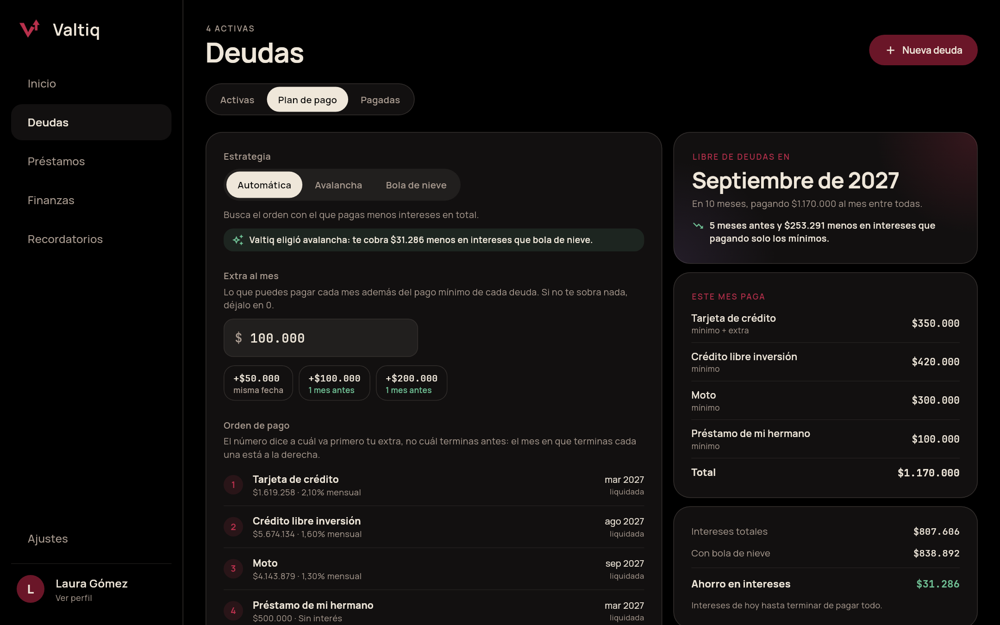
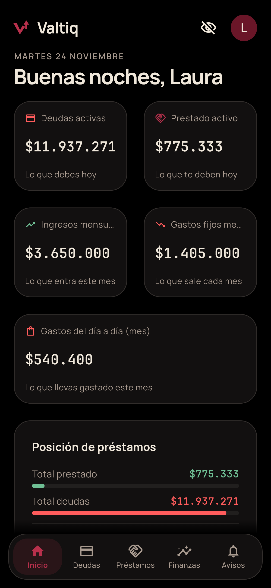
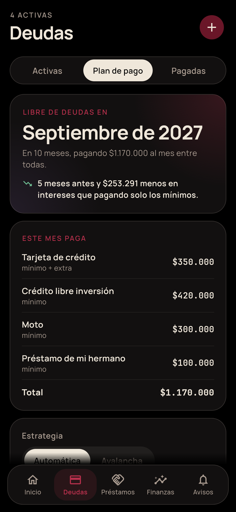
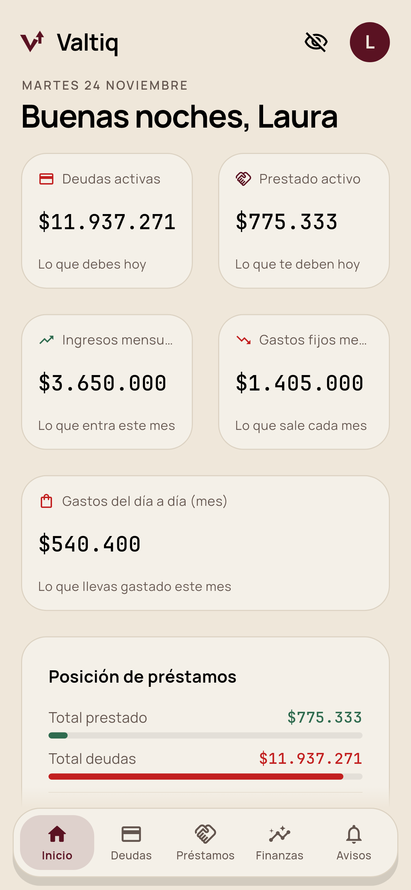
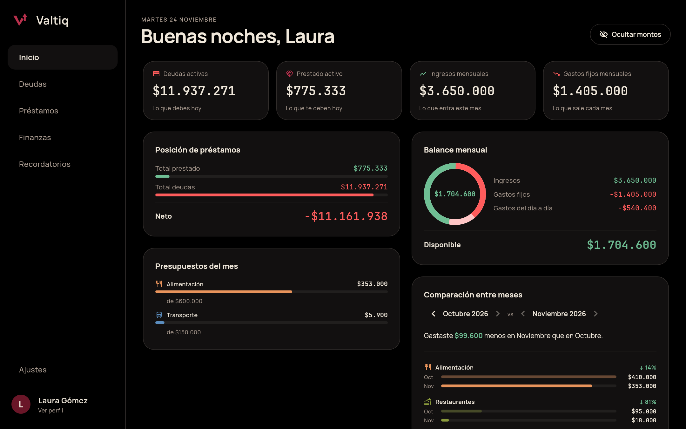
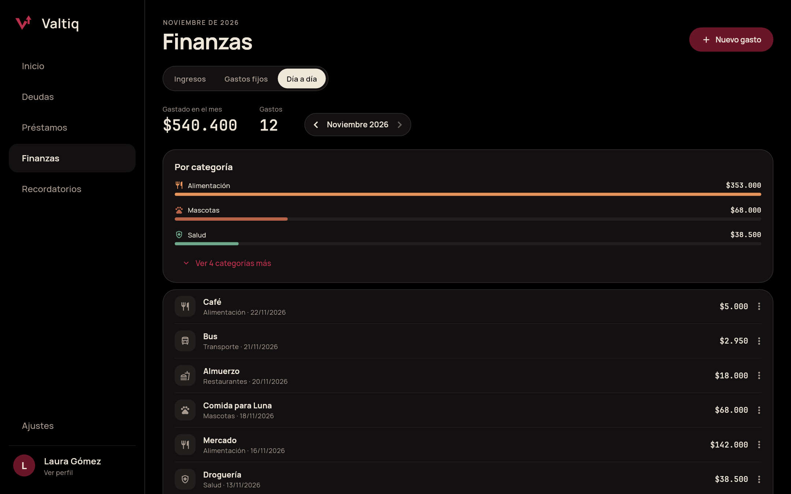

# Valtiq

Valtiq es una app de finanzas personales hecha en Colombia. Anota tus
gastos en segundos, sal de deudas con un plan claro y no olvides la plata
que le prestas a otros.
Sin crear cuenta, sin nube y sin publicidad: tus datos se quedan en tu
dispositivo.

Código abierto bajo la licencia GNU GPLv3.

<p align="center">
  
</p>

<p align="center">
  
  &nbsp;
  
  &nbsp;
  
</p>

> Las capturas usan datos inventados.

## Qué hace

**Gastos del día a día**
- Widget de Android para anotar un gasto en una línea, como le escribirías
  a un amigo: "café 5000", "almuerzo 12 mil".
- Ingresos, gastos fijos y gastos del día a día por categoría. Las
  categorías se pueden crear, renombrar y borrar.
- Presupuestos mensuales por categoría y comparación entre meses.

**Deudas y plan de pago**
- Interés simple o compuesto, sobre lo prestado o sobre lo que falta por
  pagar, con la convención bancaria colombiana para los días 29 a 31.
- Cada cálculo se puede revisar paso a paso ("¿Cómo se calculó?").
- El Plan de pago dice cuándo quedas libre de deudas y cuánto pagarle este
  mes a cada una. Elige solo el orden que menos intereses cobra (o eliges
  tú: avalancha o bola de nieve), prioriza las fechas límite y sugiere el
  extra que te falta para cumplirlas.

**Préstamos**
- La plata que le prestas a otros, para no olvidarla: con o sin interés,
  con cada abono que te hacen y lo que falta por cobrarte. Lo que alguien
  te presta a ti va en Deudas.

**Y además**
- Recordatorios de pago que en Android llegan a su hora aunque la app esté
  cerrada, y aviso opcional por correo (SMTP propio).
- Bloqueo con PIN, huella o rostro (opcional).
- Tema claro y oscuro. En computador, menú a la izquierda o arriba.
- Copia de seguridad en un archivo para pasar tus datos entre el celular y
  el computador, y opción de borrar todo.

<p align="center">
  
  
</p>

## Plataformas

| Plataforma | Estado |
|------------|--------|
| Android 6.0 o superior | Probada |
| Linux | Probada |
| Windows | Experimental: compila, pero no se ha probado a fondo |

## Privacidad

Valtiq no recolecta ni envía datos: no tiene servidores, analítica ni
publicidad. Solo se conecta a internet si activas los avisos por correo, y
solo con el servidor de correo que tú configuras. Lee la
[política de privacidad](docs/PRIVACY.md) completa.

## Compilar

Requiere Flutter 3.32.1.

```bash
flutter pub get
flutter build apk --release   # Android
flutter build linux           # Linux
flutter build windows         # Windows (requiere Visual Studio)
```

Más detalles en [docs/ANDROID.md](docs/ANDROID.md) y
[docs/WINDOWS.md](docs/WINDOWS.md).

## Stack

| Componente     | Tecnología |
|----------------|------------|
| Framework      | Flutter 3.32.1 / Dart |
| Base de datos  | SQLite con drift (schemaVersion 15) |
| Notificaciones | flutter_local_notifications |
| Correo         | mailer, con la contraseña cifrada con AES-256 |
| Seguridad      | local_auth (biometría) y PIN propio (SHA-256 con salt) |

## Estructura

```
lib/
  db/        # tablas drift, migraciones, DAOs
  screens/   # inicio, deudas (y plan de pago), préstamos, finanzas, recordatorios, ajustes
  services/  # cálculo de interés, plan de pago, notificaciones, respaldo, bloqueo
  theme/     # colores, tipografía, espaciado
  utils/     # formato de pesos, fechas, campos de formulario
docs/
  ARCHITECTURE.md   # base de datos, cálculos y decisiones de diseño
  CHANGELOG.md      # historial de cambios
  decisions/        # registros de decisiones de arquitectura (ADR)
```

## Reportar un error o proponer una idea

Abre un [issue](../../issues/new/choose). Si encontraste un problema de
seguridad, no lo publiques: sigue los pasos de [SECURITY.md](SECURITY.md).

## Licencia

GNU General Public License v3.0. Ver [LICENSE](LICENSE).

Las fuentes Manrope y JetBrains Mono incluidas en `assets/fonts/` usan la
SIL Open Font License 1.1 (texto junto a cada fuente).
